<p align="center">
  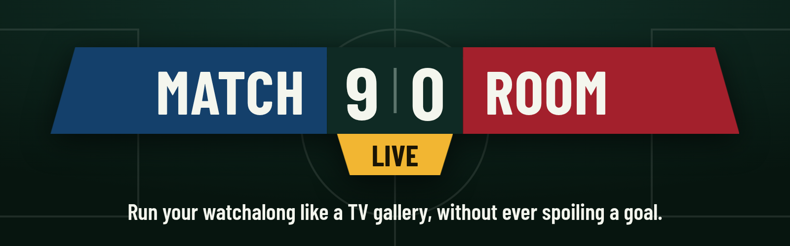
</p>

<p align="center">
  <b>A self-hosted football overlay for watchalong streamers.</b><br>
  Live score, stats, lineups, radar and goal moments on your stream, automatically, and held back until your viewers see the action.
</p>

<p align="center">
  <a href="#start-in-3-steps"><b>Start in 3 steps</b></a> &nbsp;·&nbsp;
  <a href="#never-spoil-a-goal">Stream delay</a> &nbsp;·&nbsp;
  <a href="#everything-you-can-put-on-air">Widgets</a> &nbsp;·&nbsp;
  <a href="#questions">Questions</a>
</p>

<p align="center">
  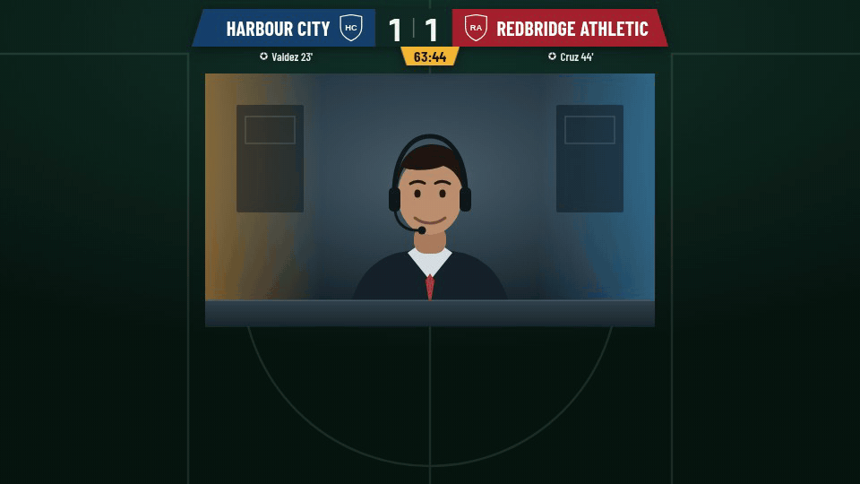
</p>

<p align="center"><sub>Recorded from the built-in rehearsal match. The clubs are fictional and the camera is an illustration.<br>The recording skips a few seconds before the goal.</sub></p>

## From webcam to matchday broadcast

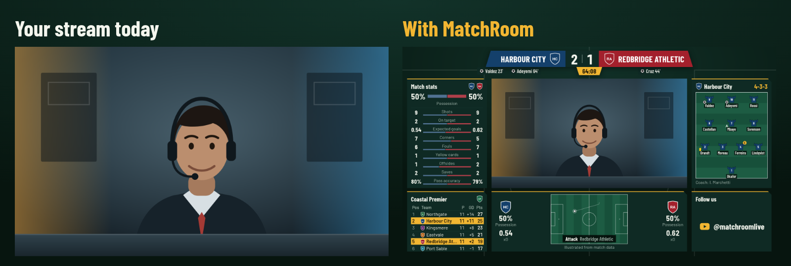

You commentate. The overlay follows the match, updating the score and clock and announcing goals, cards and substitutions without anyone touching a button.

## Start in 3 steps

The rehearsal match needs no account or API key, so you can see everything working in a couple of minutes.

### 1. Start it and pick a match

You need [Node.js 20 or newer](https://nodejs.org).

```bash
git clone https://github.com/Toxic-Joker/MatchRoom.git
```

```bash
cd MatchRoom && npm install
```

```bash
npm start
```

Open the private link it prints. That's your control room, and the rehearsal match is already playing.

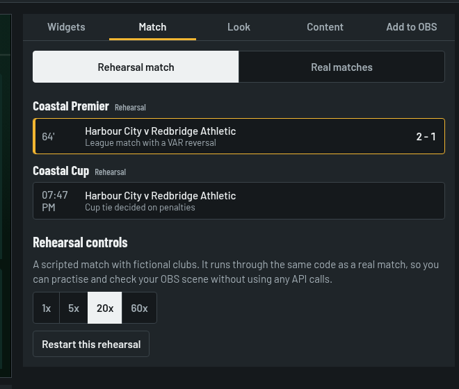

For real matches:

1. Copy `.env.example` to `.env`.
2. Add your [API-Football](https://www.api-football.com/) key.
3. Restart, then pick a match in the **Match** tab.

<br clear="right">

### 2. Light up your widgets

Each button puts a widget on air, and a lit button means it's showing. Each area of the screen holds one widget, so lighting a new one replaces its neighbour.

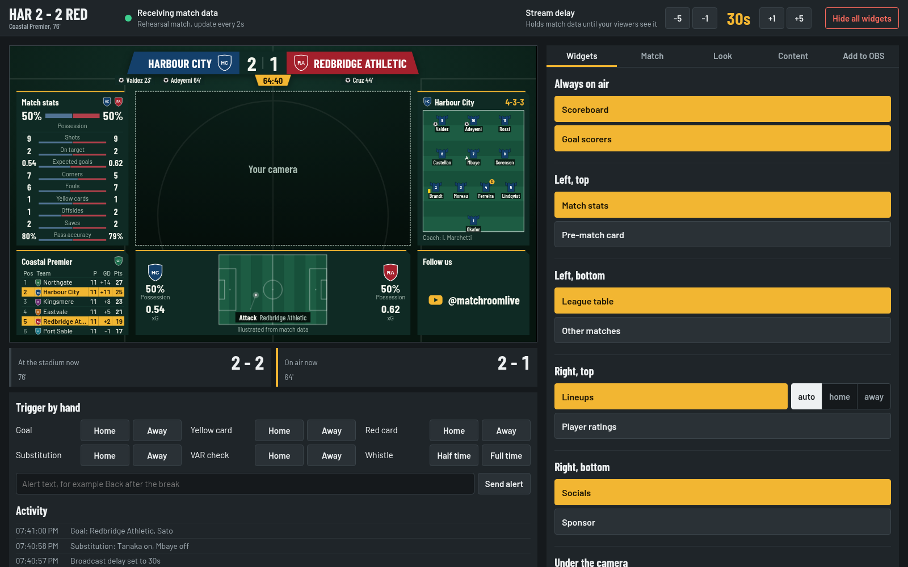

### 3. Add it to OBS

Copy the links from the **Add to OBS** tab and add each one as a **Browser source** in OBS, or in any streaming app with browser sources. No plugin is needed. Turn on **Camera position** in the **Content** tab while you line up your scene.

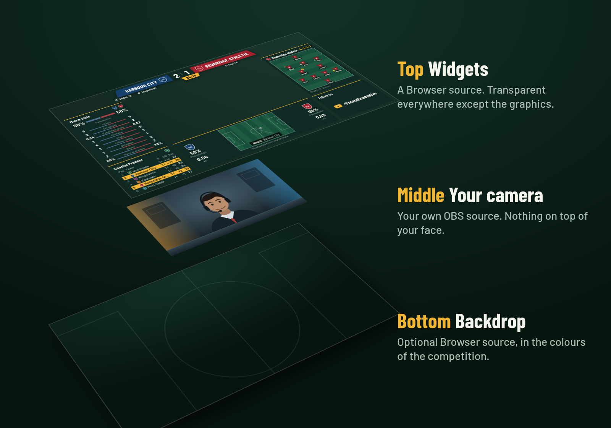

| Order in the scene | Source | Size |
|---|---|---|
| Top | Widgets link | 1920×1080 |
| Middle | Your camera | Inside the outlined area |
| Bottom | Backdrop link (optional) | 1920×1080 |

You're live.

## Never spoil a goal

Your stream reaches viewers 20 to 60 seconds after you see the match. An overlay on live data would show the goal before they see it.

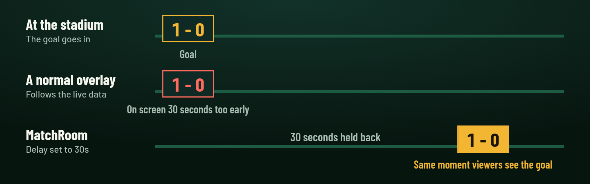

Enter how far your stream is behind in **Stream delay**, at the top of the control room. All match data then waits until it's due: score, clock, events, stats, radar and other matches. The buttons you press still work instantly.

The control room shows **At the stadium now** next to **On air now**, so you can see what's being held back.

## Everything you can put on air

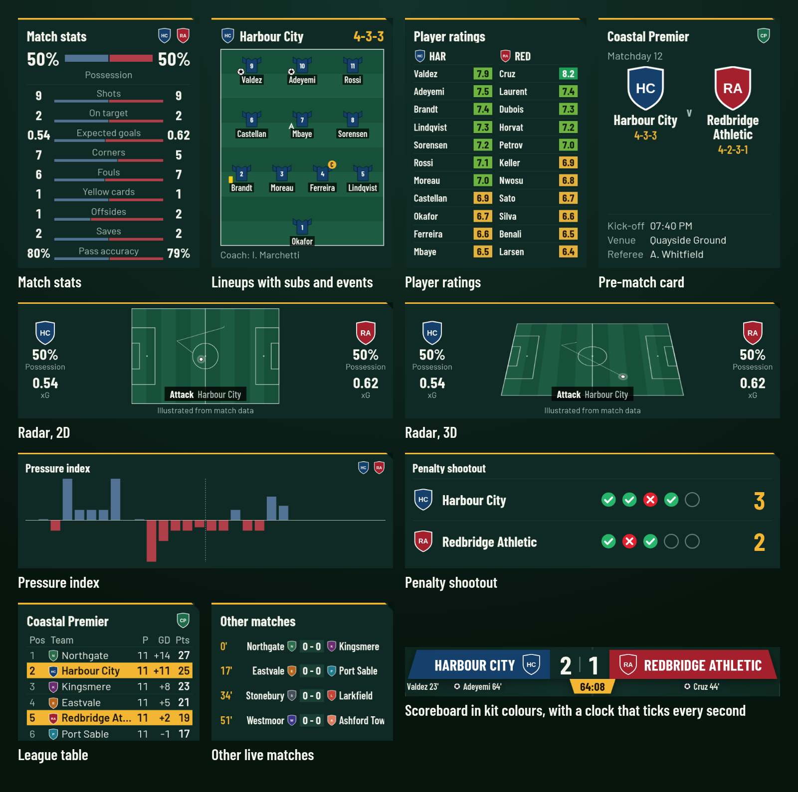

### Full-screen moments

Goals take over the screen on their own. The other screens are one click away, for before kick-off, half time and full time.

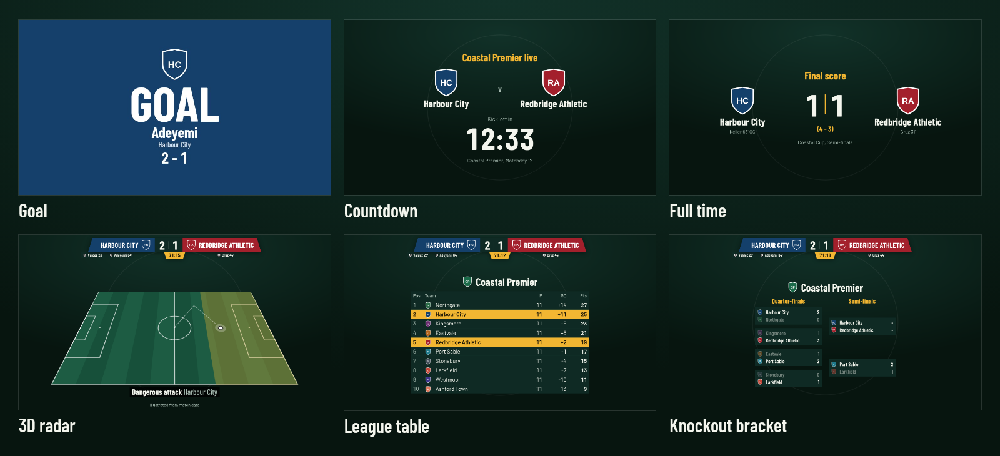

### A look for every competition

The theme follows the competition you're covering. You can also pick one yourself or set your own colours. On-air text comes in English, French, Spanish and Portuguese.

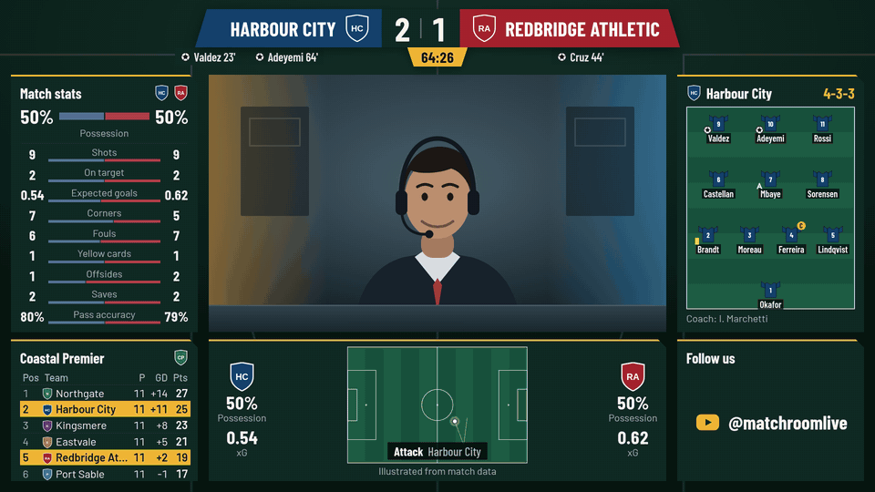

### Landscape and portrait

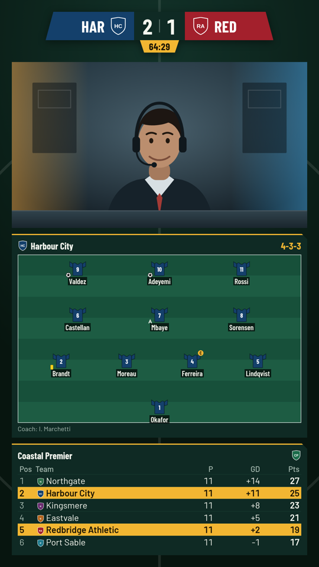

Portrait links for TikTok and Shorts work the same way, at 1080×1920. They run from the same control room, so one click updates both formats at once.

<br clear="right">

## Built for live use

- **It keeps running.** Close the control room or reload an OBS source and nothing stops. Both catch up the moment they reconnect.
- **It joins late cleanly.** Starting mid-match doesn't replay old goals and cards.
- **It handles messy data.** If a goal's scorer arrives late, the name is filled in afterwards. If VAR cancels a goal, the score is corrected on air.
- **You can step in.** Trigger a goal by hand when you see it first. The data's version then appears as a small banner, not a second celebration.
- **It works from a Stream Deck.** Add a **Website** action, paste a link from **Add to OBS**, and tick "GET request in background". Those links carry your control token, so keep them private.

## Questions

<details>
<summary><b>Does the radar show where the ball really is?</b></summary>
<br>

No. API-Football doesn't provide ball-tracking data, so the radar is an illustration of the match, and the widget says so on screen. Which side is pressing comes from the pressure index, and corners, shots, goals and cards come from the match data. Shots and corners are worked out from changes in the match totals, so they can appear a minute or more late.

Showing the true ball position would need a paid tracking feed. `server/providers/` and `Radar` are where one would connect.
</details>

<details>
<summary><b>What does it cost?</b></summary>
<br>

MatchRoom itself is free for noncommercial use, and you run it on your own machine. Match data needs an API-Football key, which may have its own cost. The free plan has a low daily request limit, and plans can restrict which seasons you can access, so check your dashboard. The server spaces its requests to make your remaining quota last the match, so updates are slower on a small plan.

For commercial use, see the [license](#license).
</details>

<details>
<summary><b>Does it show match footage?</b></summary>
<br>

No. It only shows data and graphics. It's up to you to check that your stream follows your platform's rules and your data plan's terms, and club crests in the data may have their own rights.
</details>

<details>
<summary><b>Can I control it from my phone?</b></summary>
<br>

Yes. The server only accepts connections from your own computer by default. Set `HOST=0.0.0.0` in `.env` to allow other devices on your network. Traffic isn't encrypted, so only do this on a network you trust.
</details>

<details>
<summary><b>Can I run it with Docker?</b></summary>
<br>

Yes. Your settings and tokens are kept in a Docker volume, and the last command shows your control room link.

```bash
cp .env.example .env
```

```bash
docker compose up -d --build
```

```bash
docker compose logs studio
```
</details>

<details>
<summary><b>How do I change it or contribute?</b></summary>
<br>

Run the tests with `npm test` and start a development server with `npm run dev`. [docs/ARCHITECTURE.md](docs/ARCHITECTURE.md) explains how it fits together, including how to add a widget or a data source.
</details>

## License

[PolyForm Noncommercial 1.0.0](./LICENSE): free for any noncommercial purpose. Commercial use needs a separate agreement with the copyright holder. Barlow fonts are under the SIL Open Font License, in `public/vendor/fonts`.
